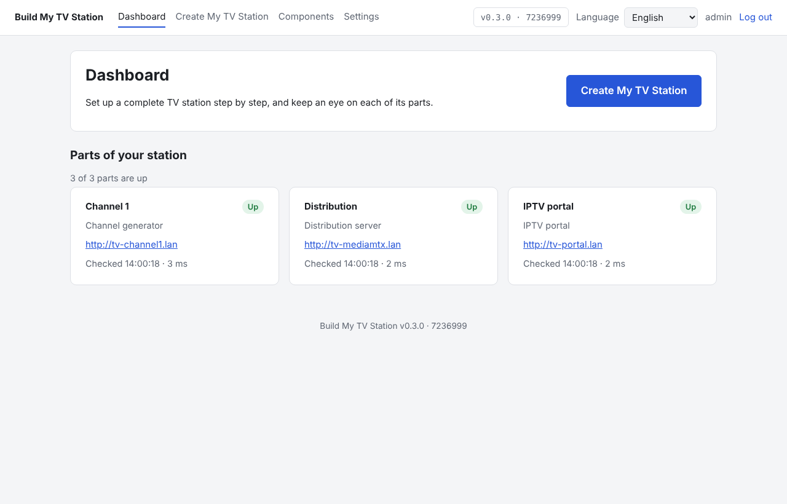
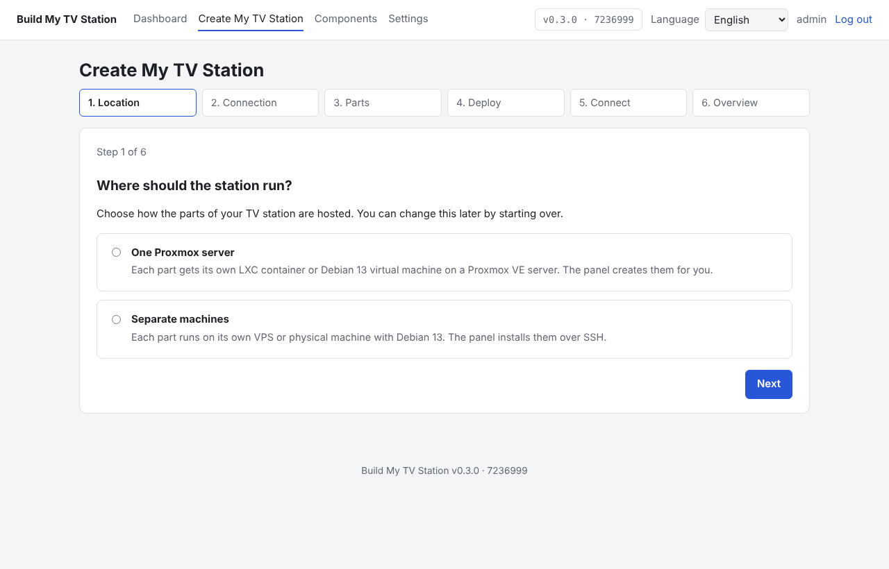
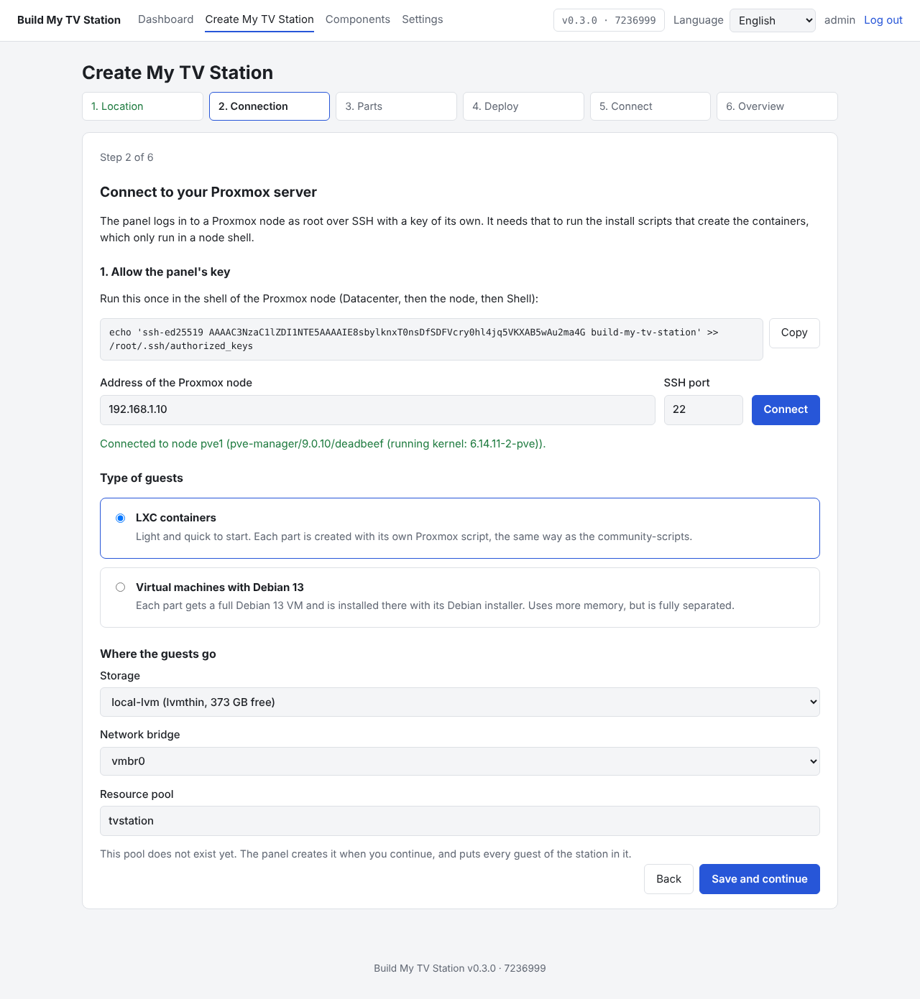
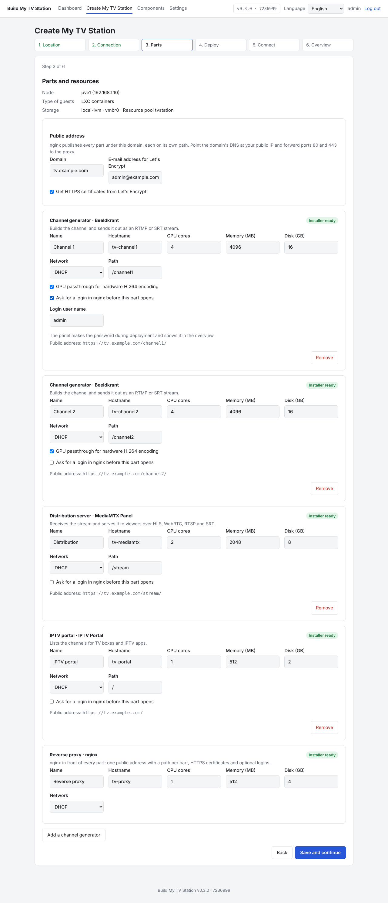
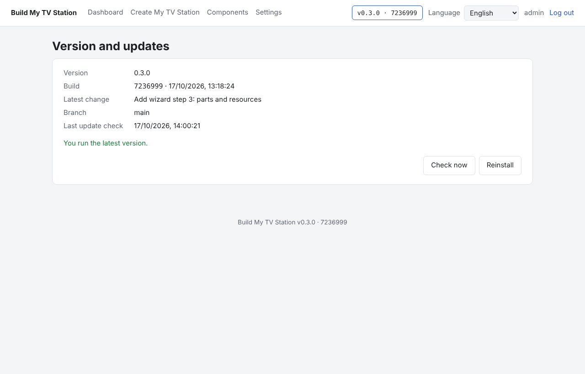
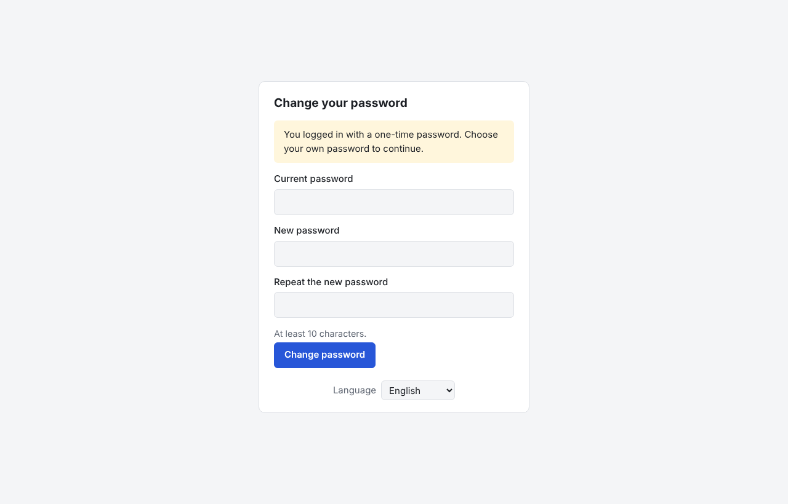
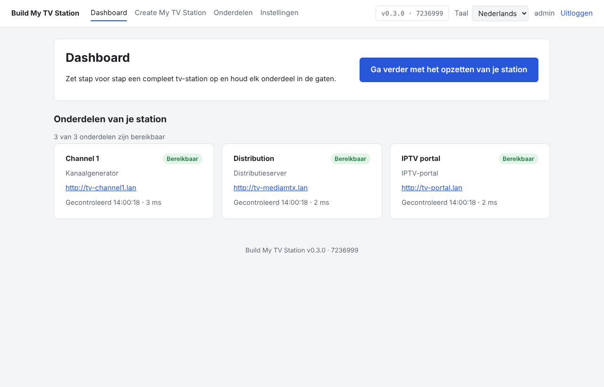

# Build My TV Station

**An orchestrator for a complete TV station.** Build My TV Station is the admin panel that ties my other projects together: it deploys each of them, connects them into one working station, puts them behind one public address and keeps an eye on every part.

You install only this panel. Its *Create My TV Station* wizard does the rest: it creates a container or virtual machine for every part on your Proxmox server (or uses separate machines), installs the latest version of each project with that project's own installer, and sets up nginx in front of them.



## The projects it orchestrates

| Part | Project | What it does |
|---|---|---|
| Channel generator | [Beeldkrant](https://github.com/rhisijmuiden/TV-Channel-Generator) | Builds the channel and sends it out as an RTMP or SRT stream. You can run several, one per channel |
| Distribution server | [MediaMTX Panel](https://github.com/rhisijmuiden/Mediamtx-controlpanel) | Receives the stream and serves it to viewers (HLS, WebRTC, RTSP, SRT) |
| IPTV portal | [IPTV Portal](https://github.com/rhisijmuiden/iptv-portal) | Lists the channels for TV boxes and IPTV apps |
| Reverse proxy | nginx (set up by this panel) | Publishes every part under one public domain, each on its own path |

```text
              Build My TV Station (this panel)
         deploys, connects, monitors and updates
                            │
     ┌──────────────────────┼──────────────────────┐
     ▼                      ▼                      ▼
 Beeldkrant ──RTMP/SRT──▶ MediaMTX Panel ──────▶ IPTV Portal ──▶ TV boxes / apps
 (channel 1..n)          (distribution)          (channel list)
     └──────────────────────┴──────────────────────┘
          nginx: https://tv.example.com/channel1/, /stream/, /
```

Each project stays a standalone project with its own installer: the panel uses those installers as they are, so every part can still be installed on its own without this panel.

- Admin panel on port **8080**
- Runs in a **Debian 13 LXC container** on Proxmox VE, or on a **minimal Debian 13** machine or VPS
- Everything (code, UI, docs) in English; the web interface is also available in **Dutch**

> **Status:** in development. Login, the one-time admin password, updates from the panel, monitoring of parts you add by hand and wizard steps 1 to 3 (location, the Proxmox connection and choosing the parts) work. Deploying the parts is next; see the [roadmap](ROADMAP.md) for what follows.

## Screenshots

| | |
|---|---|
|  |  |
| **Step 1.** One Proxmox server or separate machines | **Step 2.** Connect to Proxmox, choose LXC or VMs, storage, bridge and resource pool |
|  |  |
| **Step 3.** Parts, resources, public domain and a path per part | **Version and updates.** Update the panel from the browser |
|  |  |
| **First login.** The one-time password must be changed | **Dutch.** The whole interface is also available in Dutch |

## Install

### On Proxmox VE (LXC)

Run this in the shell of a Proxmox node:

```bash
bash -c "$(curl -fsSL https://raw.githubusercontent.com/rhisijmuiden/BulldMyTVStation/main/ct/tvstation.sh)"
```

The script uses the [community-scripts](https://github.com/community-scripts/ProxmoxVE) engine (the same one behind `ct/debian.sh`), so you get the usual choice of default or advanced settings (defaults: 1 core, 1024 MB RAM, 4 GB disk). At the end it prints the admin address and a **one-time password** for the user `admin`. If you missed it:

```bash
pct exec <CTID> -- cat /var/lib/tvstation/initial-admin-password
```

Update later by running `update` in the container shell. It updates everything in one go: the code, its dependencies, the systemd units and the commands themselves, then restarts the panel.

### On a Debian 13 machine or VPS

Run this as root on a minimal Debian 13 installation:

```bash
bash -c "$(curl -fsSL https://raw.githubusercontent.com/rhisijmuiden/BulldMyTVStation/main/install/debian.sh)"
```

Without curl, use `wget -qO-` instead of `curl -fsSL`. The installer uses Debian's own Node.js package, installs the panel in `/opt/tvstation` with its data in `/var/lib/tvstation`, and prints the admin address and the one-time password at the end. Update later with `tvstation-update` (the same command as `update` in the container); running the installer again does the same.

Settings: `PORT=<port>` changes the panel port, `TVSTATION_REF=<branch>` installs another branch.

### First login

Log in as `admin` with the one-time password. You must choose your own password (at least 10 characters) before you can do anything else. The password file is removed once it has been changed.

Lost the password? Run `tvstation-admin-reset` as root on the machine (or in the container): it prints a new one-time password and restarts the panel.

## Using the panel

- **Dashboard**: the *Create My TV Station* button and the live status of every part.
- **Create My TV Station**: a wizard in six steps (location, connection, parts, deploy, connect, overview). You can leave it and pick it up later, and go back to earlier steps.
  1. **Location**: on **one Proxmox server** or on **separate machines** (each part on its own Debian 13 VPS or physical machine).
  2. **Connection** (Proxmox): the panel shows its own SSH public key with the command to allow it on the node (`/root/.ssh/authorized_keys`). After *Connect* it shows the node, its Proxmox version and host key, and lets you choose LXC containers or Debian 13 virtual machines, the storage (only the ones that can hold that type), the network bridge and a **resource pool**. The pool is created when it does not exist yet, and every guest of the station goes into it.
  3. **Parts**: the parts of the station and the resources of each one (cores, memory, disk, DHCP or a static address, GPU passthrough for a channel generator in an LXC container). You can add several channel generators (*Channel 1*, *Channel 2*, ...); the other parts exist once. Each part shows whether its installer is ready (LXC uses each project's Proxmox script, VMs and separate machines its Debian installer).
     The **reverse proxy** (nginx) publishes everything under one public domain, each part on its own path, for example `https://tv.example.com/channel1/` for the first generator and `/stream/` for the distribution server. The IPTV portal stays at `/`, because TV boxes and IPTV apps expect it there. Tick *Let's Encrypt* for a certificate (needs an email address) and *login* on a part to put an nginx password in front of it. The paths are handled in nginx alone, so the projects themselves stay unchanged and keep working on their own.
- **Components**: the parts this panel monitors. Add a part that already runs by its web interface address; the panel checks it every 30 seconds.
- **Settings**: the default language and your password.
- **Version button** (top right): shows the version and build (`v0.1.0 · <commit>`) and opens *Version and updates*, with the build date, the latest change and the branch. The panel checks for a new version once a day and on *Check now*; when there is one, a banner appears and **Update now** installs it. The panel restarts and the page reloads on its own. The log of the last update is shown below.

Updating from the panel runs the same `tvstation-update` command as root through the `tvstation-update.path` and `tvstation-update.service` systemd units, so the web server itself never needs root.

Every user can pick English or Dutch in the language menu; the default for new users is set under Settings.

## Development

Requires Node.js 20 or newer.

```bash
npm install
DATA_DIR=./data npm start   # http://localhost:8080
npm test
```

The first start prints the one-time admin password and stores it in `DATA_DIR/initial-admin-password`. Translations live in `public/locales/`; `npm test` checks that every language has the same keys as English.

| Path | What |
|---|---|
| `server/` | Express server: auth, settings, wizard state, component monitor |
| `public/` | The single-page admin panel and its translations |
| `ct/tvstation.sh` | Proxmox LXC script (community-scripts engine) |
| `install/tvstation-install.sh` | Runs inside the new LXC container |
| `install/debian.sh` | Standalone installer for Debian 13 |
| `scripts/` | The `update` / `tvstation-update` and `tvstation-admin-reset` commands |
| `deploy/` | systemd units for the panel and for updates started from the panel |
| `ROADMAP.md` | Where the project is going, milestone by milestone |
| `docs/station-contract.md` | The optional hooks the other projects offer so the panel can deploy and connect them |
| `docs/screenshots/` | The screenshots in this README |

## License

MIT
